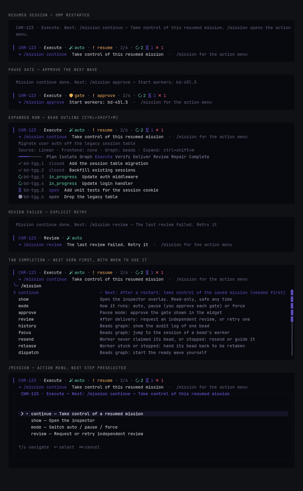

# omp-mission

Plan and run a ticket or task through verification and review. The row above the editor is the live state, and the line under it says what to run next.



OMP 18.4.4 or later. Restart OMP after install.

## Install

```text
/marketplace add Shadorain/omp-mission
/marketplace install mission@omp-mission
```

Or clone it into the extensions directory:

```bash
git clone https://github.com/Shadorain/omp-mission.git ~/.omp/agent/extensions/omp-mission
```

## Use

```text
/mission CHR-142
/mission owner/repo#123
/mission -- Fix the session cookie path
/mission CHR-142 --force --pause --keep
```

`--force` starts outside plan mode and requests review. `--pause` waits at each gate. `--keep` leaves worker tabs up.

```text
/mission show | config | history
```

**Not sure what to run? Type `/mission`.** On an active mission it opens the action menu: only commands valid right now, the next step first (`▸`) and preselected. Completed missions put `show` first and preselect it; `clear` remains an explicit start-over choice. `continue` is not a next-step command. It takes control of a saved mission after an OMP restart or resume, and until you run it `approve`, `review` and `dispatch` stay read-only (`review` and `mode` are queued and applied by `continue`).

Autocomplete keeps `show`, `config`, and `history` visible. `continue`, `approve`, `review`, `mode`, and `clear` appear only when relevant. Worker controls (`focus`, `resend`, `release`, `dispatch`, `reap`) stay out of the bare menu, but the one the widget recommends is listed there and in tab completion without selecting a bead first. The others remain directly callable.

**Past runs:** `/mission history` opens a read-only completed-mission browser. `/mission history <run-id>` opens a specific run; a ticket ID filters its completed runs. The bare `/mission` menu is commands and flags only. Ticket ids complete once you type a prefix. Browsing does not attach the archived run, change the active mission, or take controller ownership. Cleared runs remain in history. `/mission history <bead-id>` still shows an active mission bead's audit log.

**Start over:** `/mission clear` detaches a completed mission or discards an unstarted plan, including in plan mode. Saved mission history, beads, files, and external worker panes stay untouched. The cleared mission is excluded from lookup in this session, including after resume; `/mission` can then create a fresh plan with a new run ID. Clearing an unfinished saved mission is refused. Normal plan approval, Pause gates, and controller ownership still apply to the new run.

Saved-ticket lookup matches repository **and worktree path**, not just repository and ticket ID. A new worktree for the same ticket does not inherit an older worktree's completed mission.

**After delivery:** `/mission check` on a completed mission with a pull request sends the pane to inspect it: it merges the base into the PR head (a merge commit, never a force push), resolves conflicts, answers and resolves open review threads, fixes failing CI checks from their failed logs (never by disabling, skipping or weakening a check; failures that also fail on the base are reported with evidence), then records the outcome (`clean`, `merged`, `closed`, `conflict`, `threads`, `checks`, `fixing`, `unknown` with open/total thread counts) as `mission.check`. The result republishes to the status file, so the board's **Check PR** button shows it under the card's Delivery section. The socket op is `check` (an operator click, or Holotable auto mode before landing); the pane reports through `record_check`, which the board socket cannot reach.

The row under the mission summary shows the next action, for example `/mission continue` for a resumed mission, `/mission approve` at a Pause gate, or `/mission review` after a failed review. Commands appear only when the operator can act; quota blocks explain the prerequisite instead of offering a blind retry. Tab completion lists the next-step command first; worker-level recommendations remain in the action menu. Attaching a saved mission also prints the next step.

Commands you type run directly, with no model turn. Only model-initiated operations go through the `mission_control` tool and its native approval. Tool results are compact; the full source and worker assignments stay in the saved mission, not in context.

Tab completes the next argument. `ctrl+shift+m` expands the row. `ctrl+shift+f` opens the inspector. `ctrl+shift+o` cycles mode.

The compact row shows the ticket, phase, mode, and actionable status. Session names and rows omit source prefixes such as `linear:`; custom session names are preserved. Source, frontend, graph, native plan state, and the expand shortcut appear in the expanded row and inspector instead. The inspector hides the editor row while open. While a mission is visible, its configured expand key takes precedence over OMP's model-picker shortcut; without a mission, OMP keeps its normal key handling.

## Configuration

`~/.omp/agent/mission.json`. Bare `/mission config` displays the path and all configured values, including shortcuts. If the active mission uses a different graph, that graph is shown separately. A write says `Configuration set at ~/.omp/agent/mission.json: graph beads`.

```text
/mission config graph beads
/mission config frontend orca
/mission config frontend custom -- omp --print
/mission config modelRole slow
/mission config workerRole task
/mission config autoDispatch on
```

| Key | Default | |
| --- | --- | --- |
| `graph` | `local` | `local` works in this pane. `beads` is the durable worker graph. A running mission keeps the graph it started with. |
| `frontend` | `none` | `none`, `orca`, `herdr`, `custom`, or `subagent`. |
| `workerContext` | `project` | Context files a `subagent` worker loads: `project` (your `<agentDir>/AGENTS.md` plus the checkout's `AGENTS.md`, else `CLAUDE.md`), `all` (everything OMP discovers), or `none`. Context files ride in every request, so this is the largest fixed cost of a worker. |
| `reviewContext` | `project` | The same choice for review sessions. |
| `maxWorkers` | `2` | Integer from 1 through 8. |
| `modelRole` | `default` | OMP model role for the independent review session: `default` (the coordinator's own model), `slow`, `smol`, or any role in `modelRoles`. `@default` and `default` are the same. A role that does not name one available `provider/id` model falls back to the coordinator's model; the model used is recorded on each review round. |
| `workerRole` | `task` | Model role for bead workers, passed as `--model` for every frontend. A role with no configured model, or `default`, leaves workers on the default model. |
| `autoDispatch` | `false` | When on, ready waves in Auto and Force modes start without a model turn or per-wave tool approval. Pause mode, resume hold, plan mode, and lost ownership still stop it, and a failed attempt is handed to the coordinator. |
| `controls` | `false` | Inspector action button. `/mission actions` and other commands remain available either way. |
| `keys` | `ctrl+shift+m`, `ctrl+shift+f`, `ctrl+shift+o` | `expand`, `fullscreen`, `mode`. `null` turns one off. |

`PI_CODING_AGENT_DIR` or `OMP_AGENT_DIR` replaces `~/.omp/agent`.

## Orca workers

Workers receive the full multiline assignment through OMP's startup `@file` argument, not a composer paste. The assignment is short: bead, paths, rules. The ticket text is written once per mission to a shared file the worker reads only when the bead lacks context. `/mission focus <bead-id>` reads the persisted worker identity before switching tabs.

`/mission resend <bead-id>` sends a short instruction to read the assignment file. Input acceptance alone is not delivery: if Orca cannot confirm a started turn, inspect the worker tab before retrying. For an old worker with its assignment still pasted in the composer, submit that existing draft rather than pasting it again.

Restart or resume OMP after updating extension code. `/reload-plugins` does not reload extension factories.

A worker never stalls a mission silently. If its terminal disappears while the bead is unclaimed, the dead record is replaced automatically and the next action becomes `dispatch`. A live worker that has not claimed its bead within 3 minutes surfaces as `resend`, answered by one `resend` after inspecting the tab. A resume hold blocks both until `/mission continue`. Auto missions stop at delivery unless review was requested; run `/mission review` to continue into the independent review.

## Subagent workers

`/mission config frontend subagent` runs each bead in an in-process OMP session instead of a separate terminal or `omp -p` process. Beads graphs only. The session has file, shell, and search tools plus `yield`, no extensions, MCP, skills, or rules, and approvals are off (`yolo`). Shell commands run in the foreground until they finish (no auto-background, no async jobs): the session has no wait tool and its turn ends at yield, so a backgrounded `cargo auto` used to end in a `done: false, "waiting"` result. Sessions appear in the Agent Hub (`Alt+A`) as `<bead-id>`.

The extension, not the worker, owns `bd`. It claims the bead as the bead's own actor before the session starts. The worker returns `{done, summary, verification}` through the native yield tool. A launch baseline and mutating-tool traces attribute shared-checkout changes: unrelated sibling edits do not blame an innocent finisher, but attributed edits outside the worker's scope and unattributed changes outside all worker scopes leave its bead open.

A clean result stages only the worker's own changes and closes the bead with its summary and verification. `done: false`, a missing yield, or a failed `bd close` leaves the bead claimed and surfaces `resend` with the reason.

`/mission resend <bead-id> [guidance]` continues the same session with the rejection and guidance (a live session is steered). `mission_control resend` and the socket `resend` also take `files`: extra workspace-relative paths added to that worker's allowed paths and the bead's scope before it continues, refused when they overlap another open worker's scope. A leaf whose text asks it to update a doc, index or audit file outside its scope finishes on one resend instead of stopping twice and blocking the mission. `/mission release <bead-id>` aborts it, unclaims the bead, and closes the worker record so a fresh worker can take the next dispatch.

Sibling scopes do not authorize a worker's own edits: mutating tools naming a changed file outside its assigned paths are rejected even when the sibling owning it is already closed. Scope checks attribute changes after execution; they are not a filesystem sandbox.

Sessions are saved under `missions/<workspace>/workers/`. After an OMP restart, once the session owns the mission and `/mission continue` has lifted the hold, a worker whose claim is still held resumes from its transcript (a session that cannot take ownership, or is still held, only observes; after a crash the old session's lock expires in 30 seconds); if the transcript is gone the claim is released and the bead is dispatched again. Closing OMP aborts live sessions and keeps their claims.

When multiple scoped beads are present, this frontend runs per-bead review in parallel, plus an integration pass for cross-bead defects on the first round. Overlapping scopes have one review owner: repair beads outrank originals, with the newest repair-link entry owning contested files. Findings carry their `beadId`. A citation outside that bead's owned files is moved to the owner, or dropped if no bead owns the path; it does not fail the target. Integration drops exact duplicate findings, not distinct defects at the same line. Later rounds re-review only beads whose owned files changed.

## Coordinator boundaries

In beads missions, implementation fixes belong to scoped worker leaves, not coordinator edits. Direct `edit`/`write` into the bound checkout is blocked, including new unbound files; `.artifacts/` remains available for evidence unless itself scoped. Blanket staging (`git add -A`, `git add .`, `git commit -a`), recognized checkout-rewriting Git commands and branch-history rewrites (`commit-tree`, `update-ref`, `read-tree`, `reset --soft`, `filter-branch`, force pushes) are blocked.

A base that moved on is integrated only through `mission_control merge_base`: with every worker closed, the extension merges the bound base (preferring a fetched `origin/<base>`) with a merge commit and clears verification and delivery. A conflicted merge stays in progress with markers in place; verification reopens naming the paths, a leaf scoped to them resolves the markers, and the coordinator concludes the merge with `git commit --no-edit`.

**Delivery carries only mission work.** `record_delivery` and completion compare the branch with its merge-base: any committed file that no bead scope or worker owns reopens verification with the paths and the fix (a leaf scoped to them restoring the base content). A stale tree replanted onto a newer base reverts every base change since and is caught here instead of reaching review or the PR.

When all workers are closed and implementation leaves are complete, shell commands are checked against implementation-file fingerprints. Observed changes invalidate later evidence and hold verification; nothing is rolled back automatically. These checks are not a shell sandbox: concurrent workers, ignored build output, and commands that outlive their tool result limit attribution.


## Checkout and bead database

Approving the plan starts the mission automatically. If the checkout you are in already belongs to the ticket (its branch or path names it, as with an Orca worktree made for the issue), it is bound too, along with its bead database, and delivery defaults to `pr` for Linear and GitHub tickets. The coordinator is told the result and its next step in the same turn. A worktree is never created automatically.

Startup shows the ticket title and a readable specification-file path, not a ticket/JSON dump. The full ticket remains available to the coordinator. Pending plans recover from session metadata. Phase labels follow recorded verification and delivery, so a review-ready mission shows **Review**, not **Execute**.

The header labels dependency-waiting tasks as **waiting** with a neutral indicator. Only explicitly blocked beads use the error indicator; waiting for another worker is not a failed task.

Provider quota or credit exhaustion parks the coordinator, worker or reviewer without completing the mission or discarding its pending plan; the park keeps the provider's error text below the blocker line. OMP owns transient retries and model fallback; the mission does not start a second retry loop. Restore quota or change the model, then use `/mission continue` for a parked coordinator, `/mission resend <bead-id>` for a worker, or `/mission review` for a review. A board-launched pane also accepts the operator-only socket op `retry-model` (`args {model}`, a `provider/id` from the session's available models): it changes the current coordinator model and saves worker and review overrides, clears the provider park, and retries only failed coordinator, review or subagent-worker work. Finished review targets are reused with their recorded model. It is advertised only while the mission is owned, out of plan mode and free of resume holds, unapproved gates and failed verification. Holotable Recovery leaves quota-held contacts alone.

Reviewer and subagent-worker sessions run on isolated settings but inherit the configured `retry.fallbackChains` and `modelRoles`, so OMP fails them over to the next model in their chain (for example a `mission-review` chain) before a capacity failure reaches the mission. Configure a chain for the review and worker roles; without one, the `default` chain applies.

Coordinator model selection belongs to OMP. `/mission continue` never selects a model: a later manual choice remains in effect, including when Holotable sends automatic Continue. Obsolete saved coordinator overrides are ignored on load.

A failed `record_verification` parks Pause and local-graph missions: after resolving the blocker, the operator runs `/mission continue`, which resets verification to pending, not passed. Beads Auto/Force instead keep the failure as the coordinator's repair step so it can fix the defect and rerun checks without an operator Continue.


Linear checkout inference uses the first ticket identifier in each branch/path component. Later identifiers for the same project, or uppercase identifiers for other projects, still flag conflicts; lowercase title suffixes such as `chr-143-domain-error-2` do not create an `ERROR-2` ticket.

Approve the plan with **Approve and compact context** or **Approve and keep context**. **Approve and clear context** starts a new session, which loses the pending mission, so nothing starts; run `/mission` again there.

`mission_control bind_workspace` with no arguments does the isolate step in code: it reuses a checkout whose branch or path already names the ticket, or creates `mission/<slug>` in a sibling `<repo>-mission-<slug>` worktree from the primary checkout, then finds the canonical bead database and picks `pr` or `local` delivery. It stops with the reason when the base branch is unresolved, the branch or path is taken, or the checkout is a linked worktree for something else. A retry reuses the worktree it already made. It never runs `bd init`: a missing database is reported with the command. Passing `cwd`, `beadsDir`, `delivery`, or `base` overrides any default.

Base selection is explicit `bind_workspace base`, then repository `git config mission.baseBranch`, then written branch instructions (including “feature branches start from”), then GitHub's default branch or `origin/HEAD`. Pin an integration line with `git config mission.baseBranch v2/backend-rewrite`. Control/status results report the bound base; delivery must use it explicitly rather than assuming `main`.

## Review and repairs

Independent review results must match the verified revision and persisted field limits. Invalid results are rejected before they enter mission history.

The diff sent to the reviewer is capped (about 300 KB). Whole per-file sections are kept smallest first; files over the cap are listed in `omittedDiffs` and the reviewer reads them directly. A reviewer turn that errors or returns no text fails with its real cause (`Reviewer error: …`, `Reviewer returned no text`) instead of a JSON parse error.

The first review measures the full change from the merge-base of `HEAD` and the bound base (preferring `origin/<base>`). Follow-ups verify the repair delta against the last reviewed file snapshot, plus unresolved findings; reassigning files to a repair bead does not reopen settled scopes or launch a whole-branch integration audit. Each snapshot records its merge-base, so after `merge_base` a follow-up covers only files the mission changed in either round, not files only the base changed. Git snapshots include uncommitted and untracked files without changing the real index or checkout. Old rounds without snapshots get one finding/task-focused follow-up, which establishes the baseline. A missing saved snapshot fails explicitly rather than silently falling back to a full rescan. Delivery and review refuse a PR-base mismatch; retargeting needs fresh evidence and a full review. Initial reviewer deadlines are 5 minutes plus 15 seconds per file, capped at 30 minutes; follow-up reviewers get a fixed 10 minutes, without timeout-driven expansion. Small repair deltas can still require tracing substantial surrounding behavior.

A requested review starts in the extension without a coordinator model turn when ready and approved. Every failure except unfunded quota retries on its own: initial reviews up to three times with 2-, 10-, and 30-minute backoff, follow-ups twice. A longer provider retry-after is still honored, with mission-keyed jitter bounded to one minute. On provider-capacity failure, no further uncached targets start; in-flight results and completed checkpoints survive. Aggregation prioritizes capacity errors and the longest retry-after. Scheduled retries advertise their time. Quota exhaustion and an exhausted retry budget require an explicit `/mission review` after correcting the failure; Pause, resume and ownership guards still apply.

`resource_exhausted` accompanied by an explicit rate limit is a temporary throttle, not proof of exhausted credits. Review retries honor provider reset durations and UTC reset times, including resets across midnight; explicit insufficient-credit errors still require operator action.

A malformed reviewer reply is sent back once in the same session with the reason. A reply that remains invalid fails the round with `[bead-id] <reason>`. Reviewers are instructed to use the full mission requirements and recorded repair/rejection decisions, and exclude cosmetic-only findings. Repair history does not silently settle distinct defects at the same location.

Reviewers rate severity by consumer impact: **critical** (data loss, security, money, a main workflow broken), **high** (an acceptance criterion or main consumer path fails), **medium** (edge-path defect or degraded behavior with a workaround), **low** (comments, docs, naming, fixtures/mocks, accessibility polish). Low findings are deferred automatically: recorded, never repaired, and never block completion. Follow-up reviews do not report them at all.

Every completed review with remaining findings wakes the coordinator for evidence-based triage before repair work can begin. It checks each claim against requirements, current code and earlier repairs, then records `mission_control triage_findings` decisions for every pending finding: **repair**, **reject with evidence**, **defer** (medium only, when no acceptance criterion or main consumer path breaks) or **escalate a genuine unresolved conflict**. Critical and high findings cannot be deferred. Confirmed defects become one scoped repair wave; duplicate, cosmetic, speculative or already-fixed claims need a recorded explanation, not another blind fix/review cycle. Subsequent independent review covers changed scopes and scopes with unresolved findings; deferred findings are passed to reviewers as settled notes, not reopened. A round with no remaining repair findings completes the mission.

When a PR-delivered mission completes, its deferred findings (each path and title once, from valid rounds) are posted once as an **Advisory review notes** PR comment. A failed post never blocks completion.

Automatic repair work has a persisted **two-cycle budget**: one cycle is a whole bound repair wave, not each worker or reviewer. The last allowed wave still runs verification, delivery and independent review. Once the budget is spent, new medium findings are deferred as well, so only critical/high defects can hold the mission. Pending claims can still be rejected with evidence, and a clean result completes normally. If confirmed critical/high findings remain afterward—even different new findings—the mission stops **blocked**, names the unresolved IDs and does not create more repair work. `/mission review` grants exactly one additional cycle after inspection; Continue, Force, model recovery and restarts never refill the budget. An already-active legacy repair wave counts as the first cycle when resumed with this policy.

Holotable can opt into **Extra repair cycle** (`auto.repairs`): one additional authorization per contact, durably bounded by its history. Updated panes distinguish a confirmed budget hold as `problem.source: repair-budget`; scoped socket `review` with `args.repairBudgetOnly: true` rejects Pause and other holds, including genuine escalations. Ordinary ownership, resume, gate and revision guards still apply. Existing panes need a restart/relaunch to load this capability; board Auto and Recovery remain separate opt-ins.

A confirmed defect surviving two linked repair attempts on distinct reviewed revisions may escalate earlier; invalidated, unchanged and untriaged legacy verdicts do not count as confirmed failed attempts. Native approval, Pause gates and ownership remain required.

Each completed per-bead or integration result is checkpointed immediately. A timeout or another target's failure leaves the round incomplete, not clean. Retry reuses finished results only when the round, revision, model, prompt, inputs, and context still match. Valid finished results remain in the first retry checkpoint, even while earlier unfinished targets occupy every reviewer slot, so progress does not reset and an interrupted retry cannot discard them. Progress survives restart and appears in the inspector. Older failed rounds without saved progress cannot recover their discarded results automatically.


Reviewers appear in Agent Hub while running and as `review <bead-id>` rows in the mission outline. Saved round transcripts and incomplete-round progress reconstruct completed and failed rows after restart; live rows replace their saved counterpart. Completed transcript paths remain in the inspector's evidence view under `~/.omp/agent/missions/<workspace>/reviews/<mission-id>/`; open one with `omp --resume <path>`. Older reviews without saved transcript or progress records cannot reconstruct individual rows.

Worker and reviewer sessions are saved but never recorded as the terminal's last session, so `omp -c` in the coordinator's terminal always resumes the coordinator and not a bead worker. A control result or `mission_status` that arrives while the extension is about to run a step itself (an auto dispatch or a review) says so and tells the coordinator to wait, instead of telling it to make a call that would fail with "Workers running" or "Mission operation already running".

Automatic waves serialize overlapping file scopes, including scopes held by live workers. A failed automatic dispatch is handed to the coordinator once instead of recursively retrying inside the preceding tool call. Control results and board actions are republished when the operation releases its busy flag.

`/mission approve` also runs the step it approves: at a wave gate it dispatches the wave, and at a repairs gate it accepts the repairs. Judgement stays with the coordinator: graph scopes, verification, delivery, repair work and rejecting findings.

When the latest independent review of the verified revision leaves no repair findings (clean, or only rejected and deferred ones), the extension marks the mission complete without a model turn — after the delivery check above and a merge-clean check: `git merge-tree --write-tree` against the bound base must merge without conflicts, else verification reopens as failed naming the contested paths and the coordinator runs `merge_base`. `record_delivery` accepts a commit of the verified files (same contents, new HEAD); any other edit after `record_verification` means verifying again. Workers get the approved plan as a file (`omp-mission-workers/<mission-id>.plan.md`) and are told to read only their slice.

Accepting local repairs advances the round and clears earlier verification and delivery. Passing verification requires changed output while actionable findings remain. Binding beads repair work, a different epic, unfinished leaves, or changed scopes clears verification, delivery, review, completion evidence and partial progress. Repair bindings advance the round; verification requires a nonempty graph whose implementation leaves are completed (`closed` or `done`).

Repair evidence becomes passed or failed with verification, rather than staying active through delivery. Explicitly rejecting every accepted finding skips repair evidence and allows unchanged output to be reverified. Delivery and independent rereview remain required for changed output.


## Holotable board

Every session with an active or pending mission publishes a read model at `<agentDir>/missions/<workspace-key>/status/<run-id>.json` (atomic tmp+rename, rewritten only on change). The board joins by worktree and shows phase, holds, workers, delivery and the next step verbatim. `verify` is the latest verification outcome (a resume hold can cover failed verification), `mode` is the current/planned mode, and `usage` retains its aggregate shape: input, output, cache-read/cache-write tokens, known estimated cost and sessions, or `null` before recorded usage.

Optional schema-1 `measurements` and `usageEvidence` are bounded numerical summaries for Holotable, not model context. Persisted counters distinguish explicit verification outcomes, repeated failures on the same captured revision, merge preflight failures, coordinator boundary failures, failed reviews and accepted repair transitions. New missions measure from creation; legacy missions begin at their first measured mutation without inventing earlier counts. Review rounds/findings, invalidations, repair links and worker reservations are derived from mission state. These are quality/rework proxies, not externally verified correctness.

Usage includes the whole associated coordinator session, only this mission's subagent worker incarnation files, and independent reviewer sessions under `reviews/<mission-id>/` (including failed/aborted reviews). Other missions' workers are excluded; terminal-worker usage is unsupported, not free. Up to three role-scoped, hashed sources expose priced/unpriced message counts and missing/malformed/reset/backlog coverage. Known associated spend is neither exact billing nor exclusive mission cost. Status publication lazily samples at most every 30 s, immediately on a run switch, once on completion and on detach; it creates no timer or model call. Transcript reads use offsets, a reusable 64 KiB chunk and 1 MiB line buffer, and a shared 4 MiB read budget per invocation. Complete lines are counted once; oversized lines are discarded with a coverage warning. File replacement/shrink resets are flagged, deleted parsed usage survives while the probe lives, and a cold restart rebuilds gradually without a persistent usage ledger. Same-inode rewrites that grow between observations cannot be detected reliably.

Reviewer usage coverage checks transcript references from every saved round (including invalidated rounds) and incomplete-round checkpoints, alongside discovered reviewer files. A missing historical transcript keeps usage partial even if other reviews still have files; restoring it clears the current missing-file gauge. This uses the existing bounded usage sample, not an additional scan loop or model call.

Status also carries `problem` for failed reviews, active-worker errors, coordinator blockers, verification failures and graph outages: kind, source, full detail, automatic retry timestamp, failed attempt and retained review counts. A null problem means healthy; missing means an older producer. Closed-worker historical errors are not current failures. A beads mission with a readable, fully closed implementation graph reports Verify rather than Running while awaiting verification.

A main-agent `ask` wait publishes `hold: question` and the question text. At session start the extension wraps the pane's ask dialog (`src/ask-bridge.ts`), because OMP's `ask` tool reads it from the same UI object at call time and offers no other way to answer from outside. While that dialog is on screen and every question parses, status also carries `ask` (the tool call id and each question's option labels, recommendation and multi-select flag) and the single action `answer`. The socket's `answer` op (`{id, answers: [{option} | {options} | {text}]}`) settles the dialog exactly as if it were answered in the pane, and closes the pane's copy; a different `id` is `stale`. Every other socket op is refused with `question-waiting` until the question is answered. Without `ask`, Holotable surfaces **Answer in mission** to focus the OMP prompt. Planning rate-limit and provider failures publish their blocker instead of inviting plan approval.

Status also carries `coordinator: {state, since}`: `working` while the pane's main agent is in a turn or OMP has already scheduled the next one (an automatic retry, a compaction continuation, awaited background work on OMP 18.12+, or a queued message), `idle` once its turn ends with nothing scheduled. The board uses minutes of idleness with nothing else running to flag a mission that stopped to ask something in plain text. `null` until the pane's first turn.
An open tool-approval prompt (OMP's Approve/Deny prompt before a tool runs, when `tools.approvalMode` or a `tools.approval.<tool>` policy asks) is held the same way: on OMP 18.11.3 and later the extension also wraps `ui.approve` (`src/approval-bridge.ts`). While a prompt is on screen, status publishes `hold: question`, the prompt's summary as the question text, `approval` (a per-prompt `id`, the `tool` when the prompt names one, the one-row `summary`, the whole `prompt` cut at 4000 characters, and its `options` in the pane's order: remembered grants, Approve, the for-this-session choice when offered, Deny last) and the action `permit`. The socket's `permit` op (`{id, answer: <option label>}`) answers exactly as that choice in the pane would and closes the pane's prompt; a different `id` is `stale`, a label the prompt does not offer is `rejected`, never a denial. Every other op is refused with `question-waiting` meanwhile, because a message steered into the pane while a prompt is open denies the call. Older OMP returns a boolean from `approve`, so its prompts stay pane-only and publish no `approval`.

A completed mission stays Complete after its pane restarts; the resumed session's inspection-only flag is not published as unfinished work. This does not authorize Continue or clear gates, blockers or quota holds.

A pane launched by the board (`OMP_HOLOTABLE_CHILD=1`) also listens on a unix control socket (`<tmpdir>/omp-mission-ctl-<uid>/<hash>.sock`, mode `0600`) advertised in the status file's `ctl` field. It is a newline-delimited JSON protocol, one request per connection: `ping`, or an operator op (`approve`, `continue`, `mode`, `review`, `dispatch`, `resend`, `release`, `reap`, `clear`, `plan-approve`) with `"operator": true`. Each op runs through the same `control()`/`decision()` path as the slash commands — resume hold, plan mode, Pause gates and ownership are enforced identically, and `approve` may carry `args.gate` to guard against a stale board render (`stale` on mismatch).

The socket is the owner pane's control authority. A second pane that attaches the same saved mission stays read-only: it holds no ownership lock, opens no socket and never overwrites a fresh owner-published status file. Socket paths are `<sha256(missionId)[:12]>-<pid>.sock`, so a relaunched pane does not unlink the previous owner's stale file. A `<mission-id>.ctl` marker inside the status directory makes a pane eligible to serve without the launch env; the extension leaves it behind after the first serve, and the board backfills it for tracked missions that predate the marker. An owning pane retries the socket on each poll pass while eligible-but-unserved, so a revived owner that missed its marker starts serving on its own. `continue` acquires the lock, reopens the socket and republishes status, and the poll loop's ~15 s ownership retry notices a released lock first.

While a pending plan awaits approval, the status file carries `plan: {path, revision}`. The open native review's file path is authoritative; otherwise the mission's `local://<slug>-plan.md` is used. Socket operations read (`plan`), atomically edit (`plan-edit`, ≤256 KiB with stale-base checks), refine (`plan-refine`, 1..8000 characters) and approve (`plan-approve`, stale-revision checks) that plan.

On OMP 18.10.4 or newer, idle pending plans open native review through `ctx.openPlanReview()` once per written revision, without interrupting streaming or queued work or reopening a dismissed unchanged plan. Typed review events refresh the context and status; `getPendingPlanReview()` also recovers an already-open review. Approval is advertised only while the native compact choice is available. It resolves with `compact`, preserving the pending mission for the usual approved-plan start; it never uses `execute`, which clears the session. Refinement resolves the native `refine` choice; a review that closes before resolution rejects instead of queuing duplicate feedback. Older runtimes retain in-pane approval and feedback prompts. Existing panes need relaunching to load updated extension code.

Board launches set per-call-site environment overrides instead of config: `OMP_MISSION_AUTOSTART` (the `/mission` arguments run at `session_start`, used with `plan.defaultOnStartup`), `OMP_MISSION_BASE` (explicit base for workspace inspection), `OMP_MISSION_CHECKOUT` + `OMP_MISSION_DELIVERY` (reuse-only `bind_workspace` of the lane at first turn, skipping ticket-name matching), and `OMP_MISSION_GRAPH` (`local`/`beads` for the planned mission). See `docs/holotable-launch.md` for the launch recipe.

## Develop

```bash
git clone https://github.com/Shadorain/omp-mission.git
cd omp-mission
bun install
bun test
bun run typecheck
```

## License

[MIT](LICENSE)
