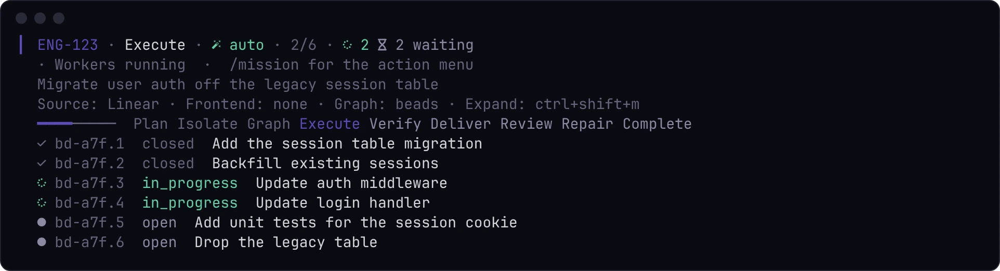
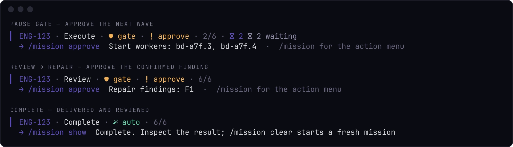
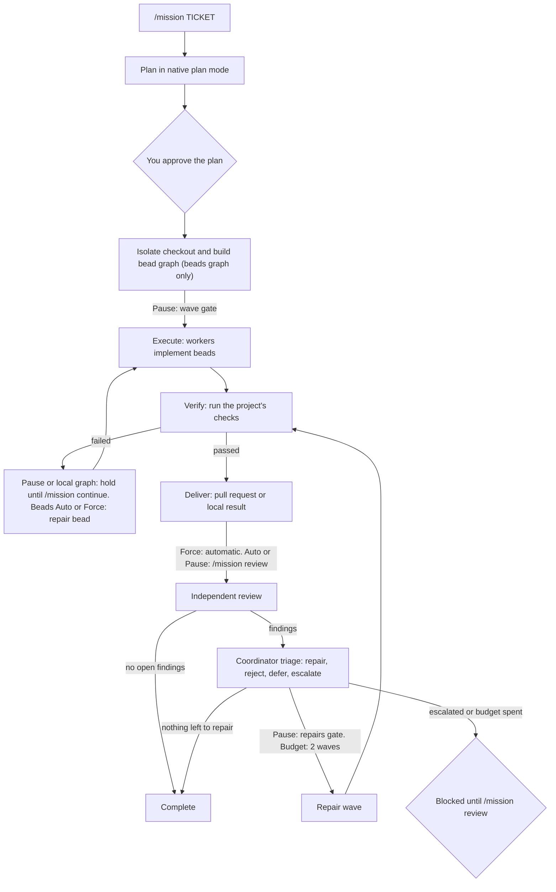
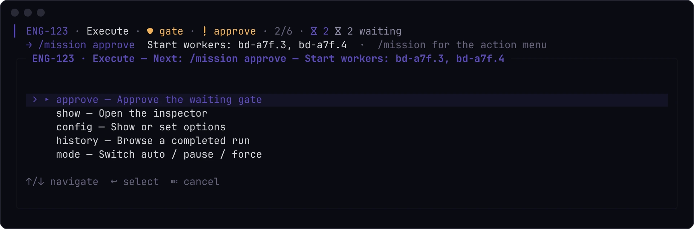
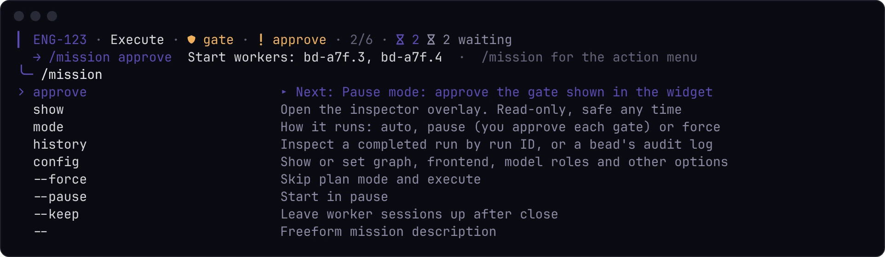

# omp-mission

An [OMP](https://github.com/can1357/oh-my-pi) extension that runs one ticket as a supervised **mission**: plan, implement, verify, deliver, get an independent review, repair what the review confirms, and finish. You type `/mission CHR-142`; the OMP session becomes the mission's **coordinator**, works through the phases, and stops at the points where a person must decide. A row above the editor always shows the mission's state and the one command to run next. Missions survive restarts, and their state is saved on disk, so you can stop, resume and inspect them at any time.



## How it works

The phases are **Plan**, **Isolate**, **Graph**, **Execute**, **Verify**, **Deliver**, **Review**, **Repair** and **Complete**. On the `local` graph (the default) the coordinator implements the change in its own pane, so Isolate and Graph are skipped. On the `beads` graph it binds a checkout, splits the work into scoped beads, and dispatches workers to implement them in waves.

Wherever the mission stops, the row says why and which command moves it on:



<details>
<summary>Lifecycle diagram</summary>

Diamonds are places where the mission waits for you.



</details>

Review comes from a separate session that did not write the code. The coordinator checks each finding against the requirements and the code before any repair starts. A completed pull-request mission can also be sent back with `/mission check` to merge the base, answer review threads and fix failing CI.

## Requirements

- OMP 18.4.4 or later. Some features need newer releases: native plan review needs 18.10.4, answering tool approvals from Holotable needs 18.11.3.
- Git, for anything beyond a local freeform task.
- The `lin` CLI for Linear tickets, or [`gh`](https://cli.github.com/) for GitHub issues and pull-request delivery.
- `bd` ([beads](https://github.com/steveyegge/beads)) for the `beads` graph.
- Orca or Herdr only if you choose those worker frontends.

## Install

From the OMP marketplace:

```text
/marketplace add Shadorain/omp-mission
/marketplace install mission@omp-mission
```

Or clone it into the extensions directory and install its dependency:

```bash
git clone https://github.com/Shadorain/omp-mission.git ~/.omp/agent/extensions/omp-mission
cd ~/.omp/agent/extensions/omp-mission && bun install --production
```

Restart OMP after installing or updating. `/reload-plugins` does not reload extension code.

## Quick start

1. Open OMP in a Git checkout whose `origin` is on GitHub, with `gh` signed in. In a Git checkout the mission delivers a pull request.
2. Start a freeform mission on the default local graph:

   ```text
   /mission -- Add a --version flag to the CLI
   ```

   OMP switches to native plan mode and the coordinator writes a plan.
3. Approve the plan with **Approve and compact context** or **Approve and keep context**. Do not use **Approve and clear context**: it starts a new session, which loses the pending mission.
4. Watch the row above the editor. When it stops, type `/mission`: the action menu lists only the commands valid now, with the next step preselected.
5. After delivery, run `/mission review` to request the independent review. The mission completes when a review leaves no open findings.

For a ticket, use its ID instead: `/mission CHR-142` (Linear) or `/mission owner/repo#123` (GitHub). To run workers on a bead graph, set `/mission config graph beads` before starting; the repository needs a bead database (`bd init`), which the mission never creates for you.

## Core concepts

| Term | Meaning |
| --- | --- |
| Mission | One ticket or freeform task run through the phases. Each run has a unique **run ID** and is saved under `~/.omp/agent/missions/`. |
| Coordinator | The OMP session that owns the mission. It plans, binds work, records evidence and triages findings. |
| Operator | You. Commands you type are your approvals. |
| Graph | How the work is split. `local`: the coordinator works in its pane. `beads`: an epic of scoped beads run by workers. |
| Bead | One task in the beads graph. Implementation beads (leaves) carry a **scope**: the files they may change. |
| Worker | A session that implements one bead. |
| Frontend | Where workers run: `none` (background `omp -p`), `orca`, `herdr`, `custom` or `subagent`. |
| Wave | A set of ready beads with non-overlapping scopes, started together. |
| Mode | `auto`, `pause` or `force`; see [Modes](#modes). |
| Gate | A Pause-mode stop before a wave, a review or a repair. `/mission approve` clears it. |
| Resume hold | A restarted or resumed session is read-only until `/mission continue`. |
| Ownership | One session controls a mission at a time, through a lock. |
| Delivery | `pr` (a pull request) or `local` (a local result, used for freeform tasks bound by `bind_workspace` and for directories outside Git). |
| Finding | One defect reported by the independent review, rated critical, high, medium or low. |
| Triage | The coordinator's decision on each finding: repair, reject with evidence, defer, or escalate. |
| Repair budget | Two automatic repair waves per mission. `/mission review` grants one more after you inspect. |
| Status file | A JSON summary of the mission that boards read. |
| Control socket | A local socket through which a board sends the same commands you type. |

## Modes

| Mode | Waves | Review | Start with |
| --- | --- | --- | --- |
| `auto` (default) | Run without asking | Only when you run `/mission review` | `/mission <ticket>` |
| `pause` | Each wave, review and repair waits at a gate for `/mission approve` | When requested, then gated | `--pause` |
| `force` | Run without asking | Requested automatically | `--force` (skips plan mode) |

`/mission mode <auto|pause|force>` changes the mode; `/mission mode` alone or `ctrl+shift+o` cycles it. `--force --pause` skips plan mode but runs in Pause with review requested.

## Commands

| Command | Use it to |
| --- | --- |
| `/mission <ticket>` | Start a mission. Sources: `CHR-142`, `owner/repo#123`, `#123`, a GitHub issue URL, or `-- <text>`. |
| `/mission` | Open the action menu, or infer the ticket from the checkout when no mission is active. |
| `/mission continue` | Take control of a saved mission after a restart or resume. |
| `/mission approve` | Approve the waiting Pause gate and run its step. |
| `/mission review` | Request review, retry a failed one, or allow one more repair wave. |
| `/mission mode [mode]` | Set or cycle the mode. |
| `/mission show` | Open the inspector. |
| `/mission check` | Inspect and fix a delivered pull request. |
| `/mission history` | Browse completed runs. |
| `/mission clear` | Detach a completed mission or discard an unstarted plan. |
| `/mission config` | Show or set configuration. |

Worker controls (`dispatch`, `focus`, `resend`, `release`, `reap`), flags (`--force`, `--pause`, `--keep`) and shortcuts are in [docs/reference.md](docs/reference.md).

Bare `/mission` opens the action menu: only the commands valid now, with the next step preselected. Tab after `/mission ` lists the next step first and says when to use each command.





## Configuration

Settings live in `~/.omp/agent/mission.json`; `/mission config` shows them and sets most of them.

| Key | Default | Meaning |
| --- | --- | --- |
| `graph` | `local` | `local` or `beads` |
| `frontend` | `none` | `none`, `orca`, `herdr`, `custom` or `subagent` |
| `maxWorkers` | `2` | Most live workers at once (1–8) |
| `reviewConcurrency` | `3` | Parallel per-bead review sessions (1–8) |
| `modelRole` | `default` | Model role for the independent review |
| `workerRole` | `task` | Model role for workers |
| `workerContext` | `project` | Context files for subagent workers: `project`, `all` or `none` |
| `reviewContext` | `project` | The same for review sessions |
| `autoDispatch` | `false` | Start ready waves in Auto and Force without a model turn |
| `controls` | `false` | Show the inspector's action button |
| `keys` | `ctrl+shift+m`, `ctrl+shift+f`, `ctrl+shift+o` | Expand, inspector, cycle mode |

Full descriptions, `customCommand`, and environment variables are in [docs/reference.md](docs/reference.md#configuration).

## Typical workflow

1. **Start.** `/mission CHR-142` fetches the ticket and enters plan mode. Review the plan and approve it.
2. **Bind.** On the beads graph, the coordinator reuses a checkout whose branch or path names the ticket, or creates a `mission/<slug>` worktree next to the repository, and resolves the base branch.
3. **Execute.** The coordinator builds the bead graph and dispatches waves. In Pause mode, approve each wave with `/mission approve`.
4. **Verify and deliver.** The coordinator runs the project's checks and opens the pull request against the bound base. A failed check stops the mission or becomes a repair bead, depending on mode and graph.
5. **Review.** Run `/mission review` (Auto and Pause) or let Force request it. Low findings are deferred automatically. The coordinator triages the rest; confirmed defects become one repair wave, which is verified, delivered and reviewed again.
6. **Finish.** A review with no open findings completes the mission after a final check that the branch carries only mission work and merges cleanly with the base. Deferred findings are posted to the PR as advisory notes.
7. **Later.** `/mission check` keeps the delivered PR mergeable: it merges the base, answers review threads and fixes failing CI.

If OMP restarts at any point, reopen the session (`omp -c`) and run `/mission continue`.

Details for each phase: [docs/lifecycle.md](docs/lifecycle.md) and [docs/review.md](docs/review.md).

## Worker frontends

On the beads graph, each bead runs in a worker. The terminal frontends (`none`, `orca`, `herdr`, `custom`) start a separate `omp` process per bead. A worker that dies before claiming its bead is replaced automatically; one that has not claimed its bead within 3 minutes is flagged for `/mission resend`.

The `subagent` frontend runs each bead in an in-process OMP session, visible in the Agent Hub (`Alt+A`). The extension claims and closes the bead itself, stages only that worker's own files, and keeps the bead open when the worker changes files outside its scope. With this frontend, review also runs per bead in parallel. See [docs/workers.md](docs/workers.md).

## Status file and control socket

Every mission writes a status file at `<agentDir>/missions/<workspace-key>/status/<run-id>.json`: phase, hold, gate, next step, legal actions, workers, delivery, review progress, current problem, usage and the mission's final **`report`** (summary, work done, verification, review counts, follow-ups and PR link, kept under 8 KiB). A pane launched by a board also serves a unix control socket that accepts the same commands you type (`approve`, `continue`, `review` and the rest), plus plan edits and answers to questions and tool-approval prompts. Every socket command passes the same checks as a typed command.

The shared format is defined in Holotable's [contract](https://github.com/Shadorain/holotable/blob/main/docs/contract.md). What omp-mission publishes and accepts is in [docs/holotable.md](docs/holotable.md).

## Holotable

[Holotable](https://github.com/Shadorain/holotable) is a separate OMP extension and local web board for running many missions as one campaign (an **operation**). It queues tickets with dependencies, launches each mission in its own pane through Orca or Herdr, watches the status files, and approves, continues and lands missions through their control sockets. It launches and watches missions; it never runs them. omp-mission works on its own without it.

## Safety model

- **Plan mode changes nothing.** The mission cannot modify anything until you approve the plan, unless you start it with `--force`.
- **You approve, not the model.** Commands you type are approvals. When the model drives the mission through its `mission_control` tool, OMP's native approval prompt applies.
- **Pause gates are exact.** A gate approves one specific wave, review or repair. If its scope changes, it needs a new approval.
- **Restarts are read-only.** A resumed session only inspects until you run `/mission continue`, and only one session owns a mission at a time.
- **Failed verification stops.** In Pause mode and on the local graph, only your `/mission continue` releases it. The model cannot record its way past a failure.
- **On the beads graph, the coordinator does not write code.** It cannot write into the checkout, stage everything, or rewrite branch history; fixes go through scoped beads. A base that moved is merged only through a dedicated merge step, never by rebase or force push. These checks attribute changes; they are not a sandbox.
- **Delivery carries only mission work.** Files outside every bead's scope reopen verification, and a branch that does not merge cleanly with the base cannot complete.
- **Repairs are bounded.** After two automatic repair waves, remaining critical or high findings stop the mission until you decide.
- **Tickets are referenced, not closed.** Pull requests use `Refs`, and Linear issues are never moved to Done.

## Documentation

| Document | Contents |
| --- | --- |
| [docs/reference.md](docs/reference.md) | Every command, flag, ticket source, shortcut, setting and environment variable |
| [docs/lifecycle.md](docs/lifecycle.md) | Each phase in detail: plan approval, checkout and base, coordinator boundaries, verification, delivery, completion, PR check, holds and recovery |
| [docs/review.md](docs/review.md) | Independent review, severity, triage, repair budget and escalation |
| [docs/workers.md](docs/workers.md) | Worker frontends, the custom frontend template, subagent workers, and implementation notes |
| [docs/holotable.md](docs/holotable.md) | Status file fields, final report, control socket ops, plan review and launch overrides |
| [docs/holotable-launch.md](docs/holotable-launch.md) | How a board launches a mission pane |
| [docs/architecture.md](docs/architecture.md) | Modules, policy and invariants, for contributors |
| [docs/runtime-smoke.md](docs/runtime-smoke.md) | Running the extension for real in an isolated agent directory |

## Development

```bash
git clone https://github.com/Shadorain/omp-mission.git
cd omp-mission
bun install
bun test
bun run typecheck
bun run format     # Biome, formatter only: tabs, single quotes, 120 columns
bun run screens    # recapture docs/screens/ from the real TUI (needs omp, bd and Chromium)
```

Contributor rules are in [AGENTS.md](AGENTS.md).

## License

[MIT](LICENSE)
